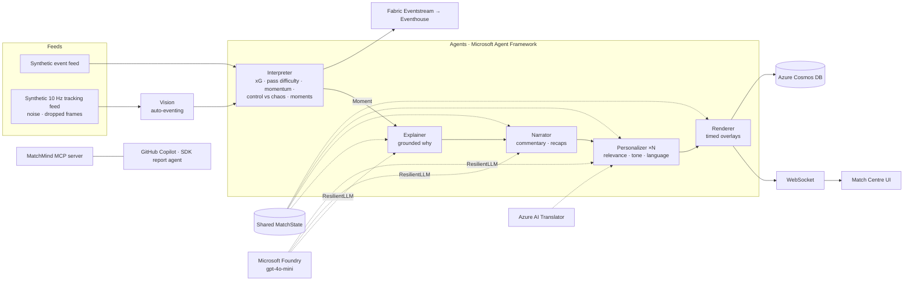

# MatchMind ⚽🧠

**Multi-agent, explainable match intelligence from synthetic football data, personalised for every viewer.**
Built for the *Inside the Game: Developer Hackathon*. Category: **Best Multi-Agent System**.

MatchMind ingests a live synthetic match, either as an event feed or as a 10 Hz tracking feed. Six cooperating agents then interpret it, explain why moments matter, narrate them, personalise them per viewer, and render them as timed, machine-readable overlays. A studio analyst and a casual fan watching the same match get genuinely different experiences, in their own language.

> All data is synthetic, generated by MatchMind's own engine. No real clubs, players, footage or trademarks are used.

📄 **Submission kit** (pitch, video script, judge instructions): [`docs/SUBMISSION.md`](docs/SUBMISSION.md)

## Pipeline



| Agent | Role | Model? |
|---|---|---|
| **Vision** | Auto-events from ball tracking: passes, interceptions, tackles, shots, saves, goals | No |
| **Interpreter** | Stats, xG, pass difficulty, rolling momentum, control vs chaos and rhythm. Detects 14 kinds of moment. | No, deterministic and under 1 ms |
| **Explainer** | Why a moment matters, citing only numbers from shared state | Foundry, with a rules fallback |
| **Narrator** | Broadcast commentary, half-time and full-time recaps | Foundry, with a rules fallback |
| **Personalizer** | Runs per viewer: relevance (mode, club, followed player, metric), tone and language | Foundry or Translator, with a rules fallback |
| **Renderer** | Lower thirds, stat cards, recaps, live player tags (speed, distance, xG, pass difficulty) | No |

**Multi-agent design:**
- **Roles.** Each agent has a distinct role and its own typed output (see [`schema.py`](matchmind/schema.py)).
- **Shared state.** The Interpreter owns a `MatchState` blackboard that the other agents read.
- **Handoffs.** Each moment's handoffs run as async tasks.
- **Failure recovery.**
  - Every model call has a timeout.
  - A circuit breaker opens after 3 consecutive failures.
  - Every stage has a deterministic fallback.
  - Load shedding kicks in when the backlog grows.
  - Translator errors fall back to English.
  - Data sinks never block the stream.
- **Observability.** Every handoff is traced live in the UI.

### Auto-eventing accuracy

Run `python -m matchmind.cli eval-autoevent` (20 matches, tracking with 0.15 m noise, 1% dropped frames and possessor flicker):

| Event | Recall | Precision |
|---|---|---|
| Goal | **100%** | **100%** |
| Pass | 99.3% | 99.0% |
| Save | 94.6% | 100% |
| Interception / recovery | 94.9% | 74.6% |
| Shot | 78.8% | 81.1% (blocked shots look like intercepted passes) |

The final score was exactly right in **20 of 20** matches.

## Microsoft and GitHub technology

| Technology | Use |
|---|---|
| **Microsoft Foundry** | Project and `gpt-4o-mini` deployment, called keylessly with managed identity (`FoundryChatClient`) |
| **Microsoft Agent Framework** | Every model call is an Agent Framework `Agent`, one per role ([`llm/provider.py`](matchmind/llm/provider.py)) |
| **MCP** | [`mcp_server.py`](matchmind/mcp_server.py) over stdio and streamable HTTP at `/mcp`. The **Azure MCP Server** is configured in [`.vscode/mcp.json`](.vscode/mcp.json). |
| **GitHub Copilot agent mode** | Repo instructions in [`.github/copilot-instructions.md`](.github/copilot-instructions.md), plus MCP servers for Copilot |
| **GitHub Copilot SDK** | Match Report agent researches through the MCP tools ([`copilot_reporter.py`](matchmind/copilot_reporter.py)) |
| **GitHub CLI** | `matchmind report --gist` publishes reports with `gh gist create` |
| **Microsoft Fabric** | Eventstream sink ([`integrations/sinks.py`](matchmind/integrations/sinks.py)) and KQL analytics ([`fabric/matchmind.kql`](fabric/matchmind.kql)) |
| **Azure Container Apps / ACR / Log Analytics** | Hosting via `azd up` ([`infra/main.bicep`](infra/main.bicep)) |
| **Azure AI Translator** | Translates rules-path text into the viewer's language ([`integrations/translator.py`](matchmind/integrations/translator.py)) |
| **Azure Cosmos DB** | Serverless and Entra-only. Stores matches, moments and overlays (partition `/match_id`). |
| **GitHub Actions** | CI (ruff and pytest) and CD (`azd up` with OIDC) |

## Run locally

```bash
python3 -m venv .venv && source .venv/bin/activate
pip install -e ".[dev]"
uvicorn matchmind.server:app --reload        # http://localhost:8000
```

With no credentials, everything runs offline on the rules path. To use your Foundry project:

```bash
cp .env.example .env     # set FOUNDRY_PROJECT_ENDPOINT and FOUNDRY_MODEL, then run `az login`
```

### CLI

```bash
python -m matchmind.cli generate --seeds 1 7 42 --out data/            # synthetic datasets (JSONL)
python -m matchmind.cli run --seed 7 --mode casual --team NBR --lang es # headless pipeline
python -m matchmind.cli eval-autoevent                                  # Vision agent accuracy
pip install -e ".[copilot]" && python -m matchmind.cli report --seed 7 --gist   # Copilot SDK report
python -m matchmind.mcp_server                                          # MCP over stdio
pytest -q
```

## Deploy to Azure

```bash
azd auth login
azd up                       # provisions Foundry, Container Apps, ACR, Cosmos DB, Translator and Log Analytics
azd pipeline config          # optional: GitHub Actions CD with OIDC
```

**Fabric (optional):**
1. In Fabric, create an Eventstream with a **Custom endpoint** source and an **Eventhouse** destination.
2. Copy the endpoint's connection string, then run:
   ```bash
   azd env set FABRIC_EVENTSTREAM_CONNECTION_STRING "<conn>"
   azd up
   ```
3. Use the queries in [`fabric/matchmind.kql`](fabric/matchmind.kql).

## Synthetic data

[`sim/engine.py`](matchmind/sim/engine.py) is a seeded match engine. The same seed always gives the same match.

**What it generates:**
- passes, carries, shots (angle/distance xG), tackles, interceptions, pressure events and possession changes
- set pieces, fouls, cards and substitutions
- ball and player speeds, and each player's distance covered

**Calibrated to look like real football:** about 80% pass accuracy, 25–40 shots and roughly 200 possession changes.

[`sim/tracking.py`](matchmind/sim/tracking.py) renders a 10 Hz ball-tracking feed from the events, with realistic noise. Sample datasets are in [`data/`](data/).

## License

MIT
