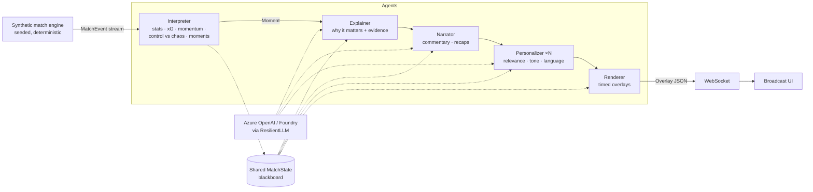

# MatchMind ⚽🧠

**Multi-agent, explainable match intelligence from synthetic football events.**
Built for the *Inside the Game: Developer Hackathon*. Target category: **Best Multi-Agent System**.

MatchMind takes a live stream of synthetic match events and runs it through five cooperating agents:

1. **Ingest** the events.
2. **Interpret** them into stats and patterns.
3. **Explain** why a moment matters.
4. **Narrate** it as commentary.
5. **Personalize** it for each viewer, then **Render** it as timed overlays a broadcast graphics engine can consume.

A studio analyst and a casual fan watching the same match get genuinely different experiences, in their own language.

> All data is synthetic and generated by MatchMind's own simulator. No real clubs, players, footage or trademarks are used.

## Pipeline



| Agent | Role | LLM? |
|---|---|---|
| **Interpreter** | Ingests every event. Maintains stats (possession, xG, pass accuracy, pass difficulty, pressures, distance and top speed). Computes rolling 5-minute momentum, control vs chaos and rhythm. Emits `Moment`s: goals, big chances, momentum swings, pressing traps, long passing spells, great passes, chaos and control phases, milestones, cards, subs, recaps. | No. It's deterministic and runs in under 1 ms. |
| **Explainer** | Says *why* a moment matters, citing numbers from the shared state only. | Yes, for important moments, with a rules fallback. |
| **Narrator** | Writes broadcast commentary, plus half-time and full-time recaps. | Yes, for goals, big chances and recaps. |
| **Personalizer** | Runs once per viewer. Scores relevance using mode, favourite club, focus player and metric, and drops what this viewer doesn't care about. Rewrites tone and language. | Yes, for non-English viewers, casual fans and recaps. |
| **Renderer** | Produces machine-readable, timed `Overlay`s: lower thirds, stat cards, recaps and live player tags (speed, distance, xG, pass difficulty). | No. |

**Multi-agent properties judges look for:**
- **Distinct roles.** Each agent owns one stage and one output type (see [`schema.py`](matchmind/schema.py)).
- **Shared state.** The Interpreter owns a `MatchState` blackboard that the other agents read.
- **Handoffs.** `Moment → Explanation → Narration → PersonalizedNarrative → Overlay`. Each one runs as its own async task, so slow model calls never block ingest.
- **Failure recovery.**
  - Every LLM call has a timeout.
  - A circuit breaker opens after 3 consecutive failures.
  - Every stage has a deterministic rules fallback.
  - Load shedding: when the backlog grows, low-importance moments skip the LLM.
  - One bad moment can never kill the stream.
- **Observability.** Every handoff is traced (agent, status, source, latency) and streamed live to the UI's agent-trace panel.

## Quick start

```bash
python3 -m venv .venv && source .venv/bin/activate
pip install -e ".[dev]"
uvicorn matchmind.server:app --reload
```

Open http://localhost:8000 and press **Kick off**. With no LLM configured, everything runs in offline (rules) mode.

### Connect Microsoft Foundry / Azure OpenAI

1. In [Microsoft Foundry](https://ai.azure.com), create a project and deploy a model, e.g. `gpt-4o-mini`.
2. Copy the endpoint and key into a local `.env`. This file is git-ignored, so never commit keys.

```bash
cp .env.example .env
# AZURE_OPENAI_ENDPOINT=https://<resource>.openai.azure.com/
# AZURE_OPENAI_API_KEY=...
# AZURE_OPENAI_DEPLOYMENT=gpt-4o-mini
```

The header chip switches from `LLM: offline` to `LLM: azure:gpt-4o-mini`. Any overlay generated by the model is tagged `llm` in the feed.

### CLI

```bash
python -m matchmind.cli generate --seeds 1 7 42 --out data/   # write synthetic datasets (JSONL)
python -m matchmind.cli run --seed 7 --mode casual --team NBR --lang es   # headless pipeline
pytest -q
```

## Synthetic data

[`matchmind/sim/engine.py`](matchmind/sim/engine.py) is a seeded match engine. The same seed always gives the same match.

**Events it produces:**
- passes, carries and shots
- tackles, interceptions, pressure events and possession changes
- set pieces, fouls, cards and substitutions
- coordinates on a 105×68 m pitch
- ball and player speeds, plus each player's distance covered
- an angle/distance xG model

**Calibrated to look like real football:** about 80% pass accuracy, 25–40 shots, roughly 200 possession changes and sensible xG.

**Sample datasets:** [`data/`](data/) has two (`match_7`, `match_42`), each with a meta file and an events JSONL file. The schema is the `MatchEvent` model in [`schema.py`](matchmind/schema.py).

**Event example:**

```json
{"id":"SYN-00007-00412","t":1384.2,"period":1,"clock":"23:04","type":"pass","team_id":"HCF",
 "player_id":"HCF-8","x":61.3,"y":22.0,"end_x":88.1,"end_y":30.4,"outcome":"success",
 "receiver_id":"HCF-9","pressure":0.41,"ball_speed_kmh":71.2,"distance_covered_km":3.9}
```

## Personalization

| Control | Effect |
|---|---|
| Mode: analyst / casual | How much tactical detail is shown, the relevance threshold and the tone |
| Favourite club | Relevance boost, plus emotional framing ("Get in!" vs "Ouch.") |
| Focus player | Their moments get boosted, and their live tag (speed, distance, pass difficulty) follows them |
| Language | en, es, fr, pt, hi, ar. Labels are translated offline; full text is translated by the LLM. |
| Metric | Chooses which stat card the persona sees: xG, possession, passing, pressing or physical |

## Roadmap (hackathon)

- [ ] Run the Explainer, Narrator and Personalizer as **Microsoft Agent Framework** agents on **Foundry Agent Service**.
- [ ] Add an **MCP server** exposing `get_match_state`, `explain_moment` and `get_player_tag` to Copilot and other agents.
- [ ] Deploy to **Azure Container Apps** using the `Dockerfile`, with the Foundry key in a Container Apps secret.
- [ ] Run Foundry evaluations for groundedness, and check that every number in an explanation exists in the state.
- [ ] Record the demo video (under 2 minutes).

## License

MIT
